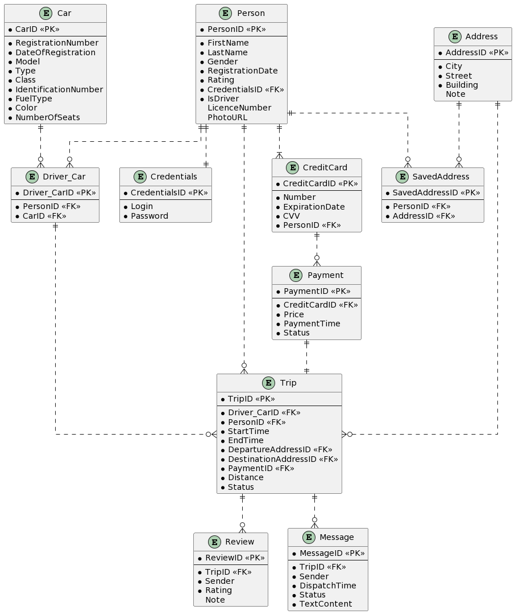

# 🚕 Ride-Hailing Service Database

A PostgreSQL database for a taxi / ride-hailing service: passengers and drivers, their accounts, cars, addresses, trips, card payments, in-trip chat and two-way reviews. The project goes from an ER model to a working database with about 700,000 rows of generated data, plus constraints, views, PL/pgSQL functions, procedures and triggers, roles, index tuning and 21 analytical queries.

🎓 Coursework for *Databases*, Igor Sikorsky Kyiv Polytechnic Institute (KPI), 2nd year, autumn semester 2023.

## 🧩 Data model



The ER model is written in PlantUML (`erd.txt`); `schema.png` shows the physical schema of the created database.

| Table | What it stores |
|-------|----------------|
| `Credentials` | login and password of an account |
| `Person` | every user, passenger or driver (`IsDriver`), with rating and licence number |
| `Car` | fleet: registration and identification numbers, model, type, class, fuel type, seats |
| `Driver_Car` | which driver drives which car (many-to-many) |
| `Address`, `SavedAddress` | trip endpoints and addresses saved by users |
| `CreditCard`, `Payment` | users' cards and card payments for trips |
| `Trip` | a ride: driver's car, passenger, start/end time, departure/destination, payment, distance |
| `Review` | rating and note left after a trip, by the passenger or by the driver |
| `Message` | chat messages within a trip |

Single-letter codes: fuel type `G`/`D`/`E` (gasoline, diesel, electric), payment status `C`/`U` (completed, unsuccessful).

## ⚙️ How it works

**Test data.** The CSV files in `import/` were generated with Mockaroo (generation notes and target ranges are in `info.txt`). `import.sql` loads them with `\copy` and creates 10,000 `Driver_Car` links by giving each of the 1,000 drivers 10 different random cars. `additional_queries.sql` then turns the raw values into a consistent data set:
- trips in 2021 between 06:00 and midnight, 10–70 minutes long
- distance derived from trip duration, price from distance (`50 * (1 + rand * 0.2) + 0.01 * distance`)
- payment and message times placed inside the trip, trip passenger matched with the card holder
- a 50/40/10 % gasoline/diesel/electric fleet, car type, class and number of seats
- about 1 % of payments marked as unsuccessful, random review notes and message lengths

**Constraints** (`constraints.sql`) cover gender and rating ranges, "drivers have a licence, passengers don't", unique logins, licence, card, registration and identification numbers, one payment per trip, a unique driver–car pair, departure ≠ destination and `EndTime > StartTime`.

**Views** (`views.sql`): `TripPrice` (trip + price), `TripCar` (trip + car), `CreditCardHolder` (card + holder's name).

**Procedures and functions** (`functions.sql`), each followed by an example call:
- procedures to insert a payment or a review and to change a trip status
- a trip's chat and the latest message of every chat of a passenger
- a driver's income and a passenger's expenses for a period
- all reviews about a driver and the trips where he was rated below 20
- saved addresses, credit cards and total number of trips of a person
- top-N drivers or passengers of a period by number of trips and time on the road

**Triggers** (`triggers.sql`):
- recalculate a person's rating as the average of received reviews after a review is added or edited
- warn when a payment is made with a card that expires within a month
- report payment status changes
- drop chat messages once a trip already has more than 100 (with a demo that inserts 101 messages)
- reject a new trip of a passenger with more than 3 unsuccessful payments
- reject linking a car to a person who is not a driver

**Roles** (`roles.sql`): `admin_user` (superuser), `driver` and `passenger` with table-level `SELECT`/`INSERT`/`UPDATE`/`DELETE` grants matching what each side may do in the app, and a time-limited `read_only_user`.

**Queries** (`select.sql`): 21 commented queries, for example top-rated drivers, drivers ranked by earnings, passengers who rode only in vans or only in Premium/Business cars, car models rated above average, the most popular addresses and cities, cards that expire soon, passengers who never took a trip and trips with failed payments.

## 📊 Index tuning

`indexes.sql` lists the existing indexes and measures two slow queries before and after adding B-tree indexes on `Trip`:

| Query | Index | Before | After |
|-------|-------|--------|-------|
| Trips per address (join on departure or destination) | `Trip(DepartureAddressID)`, `Trip(DestinationAddressID)` | 3 s | 2.3 s |
| Passengers who travelled in fewer than 5 cities | `Trip(PersonID)` | 2.8 s | 1.7 s |

## 🖥️ Running it

Requires PostgreSQL 11+ and `psql`. Run the scripts from the repository root, because `import.sql` reads the CSV files by relative path:

```bash
git clone https://github.com/pgerasymchuk/ride-hailing-database.git
cd ride-hailing-database
createdb taxi
for f in tables import additional_queries constraints views functions triggers indexes roles; do
  psql -d taxi -v ON_ERROR_STOP=1 -f queries/$f.sql
done
psql -d taxi -f queries/select.sql
```

The roles from `roles.sql` are created server-wide, once per PostgreSQL instance.

## 🗂 Project structure

```
ride-hailing-database/
├── import/      # Mockaroo-generated CSV data, one file per table
├── queries/     # schema, import, clean-up, constraints, views, functions, triggers, indexes, roles, queries
├── erd.txt      # ER model in PlantUML
├── erd.png      # rendered ER diagram
├── schema.png   # physical database schema
└── info.txt     # data generation notes
```

## 🛠️ Tech stack

- PostgreSQL, SQL and PL/pgSQL
- pgAdmin
- PlantUML
- Mockaroo
